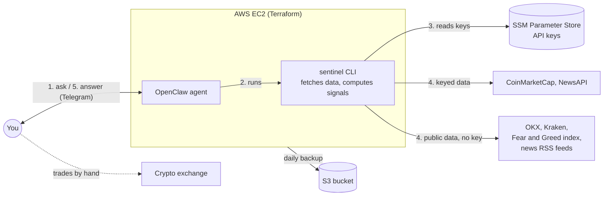

# crypto_analytic

This project is a low-risk automated agent for spot trading cryptocurrencies. It aims to achieve slow but consistent capital growth by making informed trades based on data from CoinMarketCap and the latest news.

## Architecture Diagram

You chat with the agent on Telegram. The agent (OpenClaw on an EC2 instance) never calls APIs or holds keys itself: it runs `sentinel` commands, which fetch the data, compute the signals and return a short summary for the agent to reason over. You place trades yourself.



### Agent Mindset

The core philosophy of this agent is to operate with a **low-risk profile**. It is not designed for high-frequency trading or chasing speculative rallies. Instead, it focuses on:

- **Consistency**: Making small, regular trades.
- **Data-Driven Suggestions**: Providing analysis based on market indicators from CoinMarketCap and sentiment from news sources to support user decisions.
- **Capital Preservation**: Prioritizing slow and steady growth over risky, high-reward strategies.

### Agent Context & Knowledge Sharing

It is important to understand that this repository contains the core, shareable logic for the agent, but not its full operational context (e.g., memory, specific lessons learned from individual trades).

- **Separation of Concerns**: The agent's dynamic "mindset" and experience are stored in backups on S3, not in this Git repository. This keeps the codebase clean and focused on the agent's fundamental capabilities.
- **Collaborative Knowledge**: A key future goal is to enable knowledge sharing between different users' agents. For example, `lessons_learned.md` files from multiple users, so it can be merged. By combining diverse experiences, the agent's understanding of the market becomes more robust and sophisticated over time.

This model allows for both personalized agent growth and community-driven intelligence.

## Getting Started

This guide provides the steps to get your own `openclaw` agent running. While an example using AWS and Terraform is provided, the agent is designed to be platform-agnostic and can be deployed on any server or cloud provider.

### 1. Prerequisites

Before you begin, ensure you have the following:

*   **A Server/Compute Environment**: A place to run the agent, such as a personal server, a virtual machine, or a cloud instance (e.g., AWS EC2, GCP Compute Engine).
*   **Python 3.12**: the `sentinel` package (the agent's data tools) runs on Python 3.12 or newer.
*   **Messaging Platform Bot**: A bot for your preferred messaging service (e.g., Slack, Discord) to communicate with the agent. You will need its API token.
*   **API Keys**:
    *   **NewsAPI.org**: For news headlines (the free developer plan delivers articles about 24 h late). Fresh headlines come from free crypto news RSS feeds (CoinDesk, Cointelegraph, The Block, Decrypt), which need no key.
    *   **CoinMarketCap**: For market data (the free Basic plan is enough).
    *   **A model provider for the agent**: OpenClaw works with many models (Claude, Gemini, ChatGPT, Grok, DeepSeek and others) and can fall back to other models. This setup uses Claude Haiku through an Anthropic API key, with free Gemini models as fallbacks.

### 2. Configuration: Managing Secrets

The agent needs secure access to your API keys. Obviously, they should **never** be hardcoded in the source code. The recommended approach is to use some sort of a secret manager.
#### Example: Using AWS SSM Parameter Store

If you are deploying on AWS, you can store the API keys as encrypted `SecureString` parameters in the AWS Systems Manager (SSM) Parameter Store. The agent's IAM role will allow it to securely fetch them at runtime.

The code reads exactly these names under `/sentinel/` and refuses anything that is not a `SecureString`: `cmc_api_key`, `newsapi_key`, `gemini_api_key` (plus `telegram_token`, which you copy into OpenClaw at onboarding). Store each one without it landing in your shell history (`read -s` hides the input):
```bash
read -s KEY   # paste the key, press Enter
aws ssm put-parameter --name /sentinel/cmc_api_key --type SecureString --value "$KEY" --overwrite
unset KEY
```
Keys are only ever sent in request headers; never pass them as command-line arguments.

### 2b. The `sentinel` command line

The agent never fetches data itself: it runs `sentinel` commands, which fetch and compute, and then reasons over their compact output.
```bash
python -m venv .venv && source .venv/bin/activate   # Windows: .venv\Scripts\activate
make install                                        # pip install -c constraints.txt -e ".[ec2,dev]"
sentinel --help
sentinel health --format telegram                   # needs AWS credentials for SSM
sentinel market overview --symbol BTC,SOL
sentinel snapshot SOL --format telegram
```
Commands (JSON by default, `--format telegram` for 5 lines or fewer):

| Command | What it returns |
| --- | --- |
| `sentinel snapshot SYM` | Computed signals for one coin, BTC first: BTC regime, market mood and BTC's latest headlines, next FOMC, the coin's news (fresh from RSS feeds, plus NewsAPI's day-old headlines), funding and open interest, RSI, moving averages, ATR, returns, range levels (wick and close, with UTC dates), strength and beta against BTC. Missing sources are `null` and listed in `missing`. |
| `sentinel market scan [--limit 50]` | One row of computed signals per top coin, BTC's regime first: price, 24 h and 7 d change, RSI, position against SMA50 and SMA200, strength against BTC, distance to the 7-day wick low and high, funding, RSS news count (last 24 h) |
| `sentinel market overview [--symbol BTC,SOL]` | Fear & Greed, BTC dominance, market cap change, stablecoin share, quotes |
| `sentinel market top [--limit 15]`, `market scalp [--limit 50]`, `market whales SYM` | Legacy rule signals, scalp candidates, a rough whale check |
| `sentinel news long SYM [--limit 3]` | NewsAPI headlines that name the coin (about 24 h delayed; the snapshot adds fresh ones from free RSS feeds, no key) |
| `sentinel watch add SYM --trigger touch_below\|close_below\|close_above --level N [--tf 1d\|4h] [--stop N] [--target N] [--note ...]`, `watch list`, `watch remove ID` | Stored watches in `sentinel-sim`; `watch check` (cron, every 15 min, no LLM) posts one alert per hit to OpenClaw's local hook |
| `sentinel health`, `sentinel config show` | Readiness checks, settings |

Candles come from OKX's and Kraken's public APIs (no key; daily candles are UTC days) and are cached for 5 minutes in `~/.cache/sentinel` (`SENTINEL_CACHE_DIR`). `make test` and `make lint` run the tests (no network) and ruff; `pytest -m live` runs the smoke tests against the real APIs.

### 3. Deployment

You need OpenClaw and the `sentinel` package on your chosen server. On AWS, `openclaw/bootstrap.sh` installs both and then runs `sentinel health` as a readiness gate; `~/sentinel/.ready` appears only when it passes.

#### Example: Deploying on AWS EC2 with Terraform

This repository includes a Terraform configuration to provision the entire infrastructure on AWS. This is the quickest way to get started if you are using AWS.

1.  Navigate to the EC2 environment directory: `cd terraform/env/ec2`
2.  Initialize Terraform: `terraform init`
3.  Review the plan and apply the configuration: `terraform apply`

This will create the EC2 instance, IAM roles, and other necessary resources as defined in the architecture diagram. The `user_data` script will bootstrap the agent on the instance.
